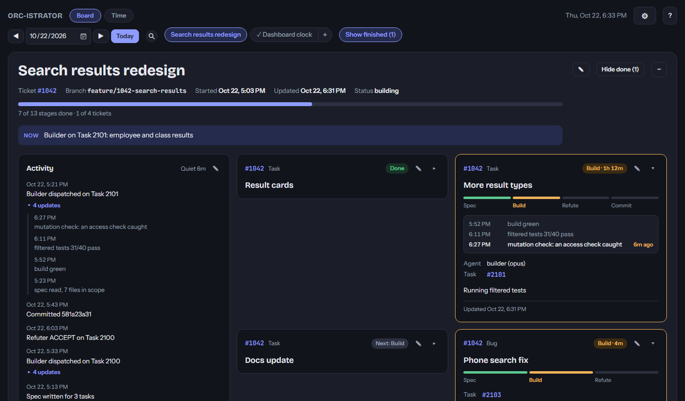
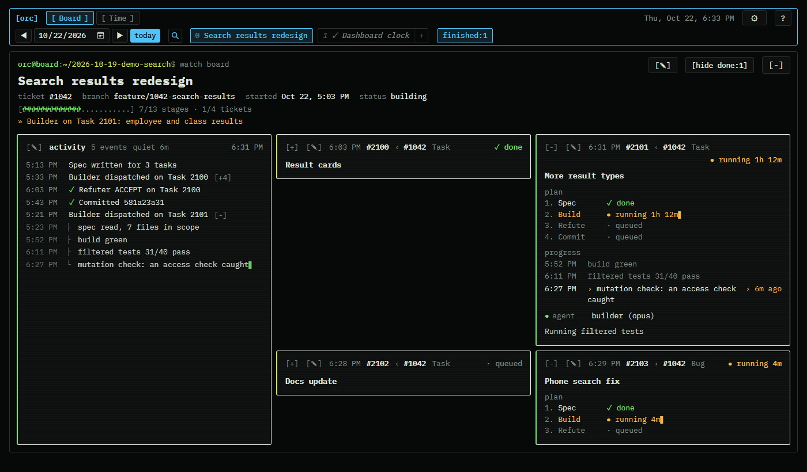
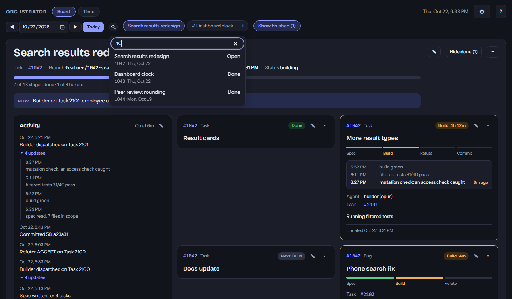
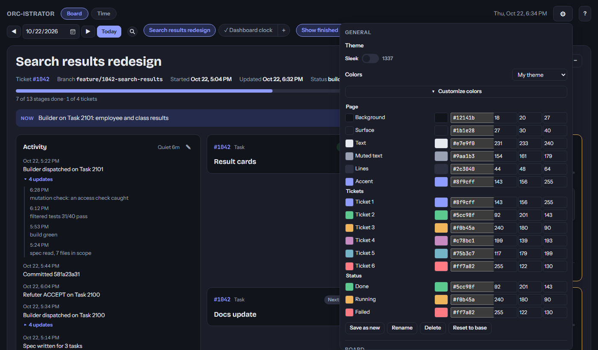
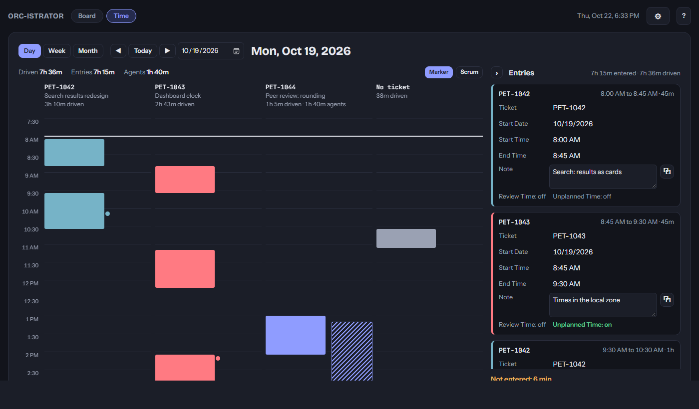
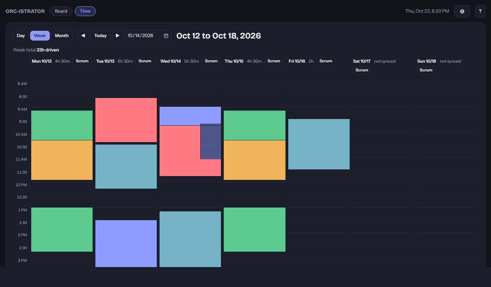

# Orc-istrator

Orc-istrator is a live status board for orchestrated agent work: one block per session, and one card per task moving through its stages (for example Build, Refute, Commit). The orchestrator (the main agent session) and its subagents write to it as they work, and the page only reads.

It exists so the person running the agents can see what each one is doing, how long it has been quiet and what it reported, without reading transcripts. It is the board half of [Orc-istration](https://github.com/Co0pDawg/Orc-istration), the method and toolkit whose rulebook points agents at this README's "Writing protocol" for when the board is written. The name keeps the repo family's spelling: Orc-istration for the setup, Orc-istrator for the board.

## Screenshots

All of these use made-up demo data.

| Board (Sleek) | Board (1337) |
|---|---|
|  |  |
| **Session search**: the magnifier (or `/`) finds any session on any day | **Theme editor**: Settings > Customize colors, saved as you go |
|  |  |
| **Time, Day**: time per ticket, Work Detail entries that copy on click, the entry marker | **Time, Week**: one column per day, each with its own Scrum button |
|  |  |

## Two ways to run it

- **As a private claude.ai artifact.** Publish the page from Claude Code under your own account and put its URL in `~/.claude/board.local.md`. Only Claude Code can write to it; anyone the owner shares it with can view it. See "Publish" below.
- **Locally.** `node local/board.js serve` runs the same page and data contract at http://localhost:8377/, stored as JSON files. Any agent tool that can run a shell command writes to it through the CLI.

## Local quick start

```
node local/board.js serve                     # foreground server on http://localhost:8377/
node local/board.js url                       # print the board URL
node local/board.js list sessions             # read every session doc
echo '{"at":"2026-01-01T09:00:00-05:00","text":"build green"}' | node local/board.js append cards/c1 progress --stdin
node local/board.js get cards/c1
```

More on the board, its data model and when it is written: the [wiki page](https://github.com/Co0pDawg/Orc-istration/wiki/The-Board).

## How it is built

Static ES modules loaded straight by the page: no build step and no dependencies. Pure logic (card state, search, time entries) is kept apart from rendering so it can be tested; `npm test` runs 176 `node:test` tests. The code rules (structure, styles, state and storage, rendering, accessibility, comments) are in [STANDARDS.md](STANDARDS.md).

---

## Reference

The sections below are read by agents at run time; their headings are linked by name from other files.

## Files

| Path | Role |
|---|---|
| `orchestration-board.html` | Page shell: title, fonts, the four stylesheets, static markup, Sortable, `js/main.js` |
| `css/tokens.css` | Color and font tokens (light, dark, 1337) and the body base |
| `css/base.css` | Skin-neutral layout and controls |
| `css/sleek.css`, `css/leet.css` | Every rule of one skin, prefixed `.sleek` / `.leet` |
| `js/util.js` | Pure helpers: `esc`, `fmt`, `t12`, `clamp`, `ago`, `ticketUrl` (ticket and task links from a session's `links` or `ado`), `httpsUrl`, `idText`, the day in a page hash (`hashDay`, `pageHash`, `fmtDay`) |
| `js/model.js` | Pure data logic: card state, stage timing, sub-event windows, which sessions were touched on a day, visible/live sessions |
| `js/prefs.js` | Every localStorage read and write |
| `js/state.js` | The shared runtime state object |
| `js/render/shared.js`, `sleek.js`, `leet.js` | HTML strings for panes, logs and headers |
| `js/board.js` | Session views, tiles, `render()`, timers, column fitting, Sortable per view |
| `js/chooser.js` | The two-row top bar: row 1 is the name, the Board / Time tabs, clock, gear and `?`; row 2 (day control, search, session chips, Show finished) shows only on pages that opt in (today only Board; `css/base.css`) |
| `js/search.js` | Pure session search: matching, ranking and each session's last-touched time |
| `js/layout-edit.js` | Per-pane edit mode (the ✎ on each pane): move/resize, corner drag, grip keys, Esc; session reorder; Settings > Layout resets and the undo toast |
| `css/palettes.css`, `js/palettes.js` | GENERATED color schemes (`npm run palettes` from `dev/palettes.json`); never edit by hand |
| `js/time/segments.js`, `entries.js`, `notes.js`, `scrum.js` | Time page pure logic: driving segments and agent spans, Work Detail entries with rounding, each entry's Note, the scrum summary |
| `js/time/render.js`, `controller.js` | Time page HTML strings (Day, Week, Month, entries, scrum dialog) and its controller (timeline subscription, date navigation, copy) |
| `js/settings.js` | The Settings gear: General (the skin switch and Customize colors) on every page, then the current page's own section: Board (Activity log fills its column, Layout reset, when a session counts as finished) or Time (Entry rounding). The Layout reset row is bound in `layout-edit.js` |
| `js/theme.js`, `js/theme-ui.js` | Themes: the pure parts (token list, merge, hex/rgb, contrast, migration, editor rows) and the Customize colors editor |
| `js/partials/settings-menu.js` | The Settings menu markup (static). Imported first by `main.js`, so its controls exist before other modules look them up |
| `js/main.js` | The only entry: binds the controllers, applies the skin, subscribes to the db |
| `js/conn.js` | Connection state per subscription and the top-bar notice ("Board server not reachable") |
| `tests/search.test.js` | `node:test` suite for `search.js` |
| `tests/model.test.js`, `tests/day.test.js` | `node:test` suites for `model.js` and `util.js` (`day.test.js`: the day filter and the hash helpers) |
| `local/store.js` | Local backend: the file-backed document store (`<data dir>/<collection>/<id>.json`) |
| `local/server.js` | Local backend: the localhost server (page, `/api/db`, `/api/events`); never published |
| `local/db-shim.js`, `local/query.js` | Local backend: the browser stand-in for `window.claude.use("db")` and its filter/sort logic |
| `local/board.js` | Local backend: the CLI agents write with |
| `local/ops.js` | Local backend: the high-level writes (`session start`, `stage`, `progress`, ...), each applied whole inside the server's write queue |
| `local/lint.js` | Local backend: write-time checks against the data contract (warnings only) |
| `.github/workflows/test.yml` | CI: `npm test` and `npm run check` on Linux and Windows, Node 22 |
| `tests/local-*.test.js` | `node:test` suites for `local/` |
| `dev/` | Preview harness (`preview.html`, `preview.js`, `fixture.js`), static server, `check.js`; never published |

## Data contract (what the page reads)

- `sessions/<date>-<project>-<slug>`: `title, ticket, branch, status, started, updated, now, completed?, links?, ado?, pr?, events[]`. `pr` is `{id, url, status}` from any host (an `https://` `url` is a link); `status` is `draft|active|open|ready` while in review and `completed|merged|closed|abandoned` once final; with the viewer's Settings rule "Its pull request is completed", a finished session whose PR is still in review stays unfinished on the board. Ticket and task links (the session's and its cards') come from `links: {ticket?, task?}`, URL templates in which `{id}` is replaced by the URL-encoded id (`task` falls back to `ticket`; only `https://` templates are used), else from `ado`, the Azure DevOps `"org/project"` (e.g. `"contoso/AcmeApp"`). With neither, ids show as plain text. An all-digit id shows as `#123`, any other id (`PROJ-9`) as written. Each event is `{at, text, sub?: [{at, text}], card?: "<card id>"}`. Events are append-only; the page keys expand/collapse state by event index. Sessions sort by `updated` descending. A session is finished when `completed` is set or `status` is Done/Complete/Completed/Finished (any case); finished sessions start minimized and stay off the chips until Show finished is on.
- The chips show only the sessions touched on the selected day (today by default): a session counts when its `started`, `updated`, `completed`, an event or sub-event `at`, or one of its cards' `updated`, `progress[].at` or `stages[].started` falls on that local day. On today finished sessions stay behind Show finished, whose count is today's finished sessions; on a past day they always show and Show finished hides. A day with nothing touched shows "Nothing touched on <day>". The day control (◀, date, ▶, Today) sits beside the chips.
- `cards/<id>`: `session, order, ticket, task, kind, title, agent, tokens, commit, note, updated, stages[], progress[]`. `stages` is an array of `{label, state, started?}` with `state` one of `done|active|rework|pending|skipped`, in plan order (the page also reads an object `{label: state}`, but write the array); `started` (ISO) is set when a stage turns active or rework, else the page falls back to the card's `updated`. `progress[]` is `{at, text}` lines posted by agents.
- A dispatch event that names `card` nests that card's `progress` from the event's time until the next dispatch for the same card. A running card shows its last three progress lines. The log shows "quiet Nm" since the newest event, sub-event or progress line, amber after 45 minutes.
- Times are ISO with offset; a missing or bad time shows as "no time". A stage `state` outside the list above shows as written, in the warning color, and never counts as done. A malformed `events`, `sub`, `stages` or `progress` entry is skipped, so the rest of the board still renders.
- When a load fails or the local event stream drops, the top bar shows "Board server not reachable; showing data from <time>" (or "Cannot reach the board server" before any data), announced once to screen readers, until a load succeeds again.
- `timeline/<yyyy-MM-dd>` (written only by the worklog sync, never by the page): `{date, synced, tz, events:[{at, kind, session, ticket}], sessions:{<id>:{project, review}}, notes:{<ticket>:text}, titles:{<ticket>:ADO title}, blocks:[{start, end, ticket, text}], flags:{<ticket>:{unplanned:true}}}`. `ticket` is `APP-NNNNN`, another tracker id (`PROJ-9`, `owner/repo#N`) or null (no ticket); events carry no prompt text. `blocks` are the worklog roll-up's time blocks (model-written descriptions, ISO times with offset); an entry's Note joins the same-ticket blocks it overlaps, a waiting-only entry's Note names the agent runs it covers (card title, else dispatch text), and `notes[ticket]` is the fallback (js/time/notes.js entryNotes). `titles` labels the scrum's Yesterday lines (an older doc without it falls back to the board's session or card title). The Time page computes driving time from these events (a prompt drives its session through that turn's `stop` plus 15 minutes, cut short by a prompt in another session) and agent time from the board's own sessions and cards.

## Writing protocol (the orchestrator and its agents)

The single source for when the board is written. `~/.claude/CLAUDE.md` says to follow it, so keep it accurate.

Two backends take the same data. Which one a machine uses: `~/.claude/board.local.md` holds either a `claude.ai/artifact/...` URL (artifact) or a `http://localhost:<port>` URL (local). The table below says WHEN to write and holds for both.

- **Artifact backend.** Writes go through the ArtifactData tool (load it with ToolSearch `select:ArtifactData`) against the board URL. If ToolSearch finds no `ArtifactData`, use `mcp__claude-artifacts__db_get`/`db_write` instead: resolve the board URL to its UUID slug with `get_artifact` first (the short id in the URL returns 400), and pass `ifVersion` on every write to an existing doc. (Learned 2026-10-29, PR 6324: ArtifactData was absent and the builder skipped its card.) Writing more than one doc uses `batch`, and every write to an existing doc pins `if_version` to the version last read; on a conflict, re-get and redo. Take times from `date -Iseconds` so they carry an offset. Bump the session's `updated` on every write so it sorts first. Never republish the page for data.
- **Local backend.** Writes go through the high-level commands of the CLI, `node <board repo>/local/board.js` (see "Local board"). Each is one request the server applies whole, stamps with its own clock (ISO with offset) and bumps `updated`, so no read, no pin and no `date` call is needed; `--if-version N` is optional and a conflict exits 2. Start = `session start` + one `card add` per card; Dispatch = `set-field cards/<id> agent <name>`, `stage <card> <label> active`, `event <session> "<agent> dispatched on #<task>" --card <card>`, `set-field sessions/<id> now "<text>"`; Check-in = `checkin <session> "<text>" --card <card>`; Report = `stage <card> <label> done|rework`, `set-field cards/<id> note "<text>"` and `tokens <n>`, `event <session> "<outcome>" --card <card>`; Commit = `set-field cards/<id> commit <hash>` and an `event`; PR opened = `echo '<json>' | node local/board.js set-field sessions/<id> pr --stdin` (JSON on a PowerShell command line loses its quotes, so JSON always goes through `--stdin`); Finish = `finish <session> --now "<closing line>"`. Text with quotes, `$`, backticks or newlines goes through `--stdin`.

| When | Write |
|---|---|
| **Start**: before the first dispatch of an orchestrated task | Create `sessions/<YYYY-MM-DD>-<project>-<slug>` (title, ticket, branch, status "Planning", started, updated, now, events: [the plan line], plus `ado` when the repo's work items are not in contoso/AcmeApp) and one `cards/<id>` per ticket or task (session, order, ticket, task, kind, title, stages with every planned stage `pending`, updated). Use one batch. Card ids are short and unique, e.g. the task id. |
| **Dispatch** | Set `agent`. The agent turns its stage `active` with `started` when its brief names the stage; otherwise the orchestrator does. Append an event `{at, text: "<agent> dispatched on #<task>", card: "<card id>"}`. Update `now` and `status`. The brief carries `BOARD: <board URL> card <card id> stage <label>` (marching orders item 10). |
| **Check-in** (the orchestrator reads a running agent's report file, test log or a late notice) | Append `{at, text}` to that dispatch event's `sub`, only if something changed. |
| **Heartbeat** (a dispatch expected to run past ~30 min) | Schedule a check every 20-30 min (Monitor on the agent's report or test-log file, or ScheduleWakeup/CronCreate). Each check posts a check-in. |
| **Report** | The stage turns `done` or `rework` (a rework stage gets a fresh `started`) and the card's `note` is set: the agent does this when its brief names the stage, otherwise the orchestrator does. The orchestrator always sets `tokens`, since only it sees the completion notice, and with that write it reads the card and corrects any stage the agent did not move (an agent that was stopped or lost its write). Append the outcome as a top-level event that names the card, `{at, text, card}` ("refuter ACCEPT", "builder done: 40 tests pass"); the Time page ends that agent's span at this event. |
| **Commit** | Set the card's `commit`; append an event naming the hash. |
| **PR opened** | Set the session's `pr: {id, url, status: "draft"}` (url is the PR's Azure DevOps link). |
| **Finish**: the task's last write | Session `status: "Done"`, `completed`, a closing `now` ("Draft PR #### opened"), and a final event. Never delete session or card docs unless the user asks. |
| **Timeline upload**: at the Start of every orchestrated task, and when the user says "sync my timeline" | For each file in `~/.claude/timeline-sync/pending/` (`timeline-<date>.json`, built every 15 minutes by the worklog's scheduled sync), `get` `timeline/<date>`, then `set` it with `file_path` = that file, pinned to `if_version` when the doc exists, and delete the file after the write succeeds. A session with only `db_write` cannot send a file: inline a doc under 64 KB, otherwise leave the file pending for a session with ArtifactData and tell the user. See the worklog README, "Uploading". |
| **PR refresh**: at the Start of every orchestrated task | For each session with `completed` whose `pr.status` is not final (`completed`, `merged`, `closed` or `abandoned`), read the PR (AcmeApp: `& ./.claude/scripts/ado.ps1 pr-get -Pr <id>`, cross-project for other repos) and write `pr.status`: `draft` while `isDraft`, else its `status`. One batch for all of them; skip when nothing changed. |

`tokens` and `note` are card fields. The page never shows them inside a stage entry.

A card at Start, exactly in this shape (stages is an array in plan order, never an object):

```json
{"session": "2026-10-20-acmeapp-18018-tab-strips", "order": 1, "ticket": "18018", "task": "18019", "kind": "Task",
 "title": "Tab restyle + Admin groups", "updated": "2026-10-20T12:02:46-04:00",
 "stages": [{"label": "Build", "state": "pending"}, {"label": "Refute", "state": "pending"}, {"label": "Commit", "state": "pending"}]}
```

Agents write only their own card's `progress[]`, `note` and the one stage their brief names, leaving the other stages as read (rules in `~/.claude/agents/builder.md` and `refuter.md`), never the session doc, where several agents would collide. The orchestrator writes the same card (`agent`, `tokens`, `commit`), so every card write is pinned. A subagent write needs no permission prompt (probed 2026-10-19).

Per-viewer state lives in localStorage: `board.skin`, `board.layout`, `board.shown` (older `board.session`), `board.fold` (older `board.folded`), `board.cardFold` (minimized cards), `board.showDone`, `board.doneWhen` (`orchestrator`, the default, which an older saved `fable` also reads as; or `pr`), `board.theme` (the selected theme: a palette id, "" for the board's own colors, or a custom theme's id), `board.themes` (custom themes `[{id, name, base, colors: {token: "#rrggbb"}}]`; the older `board.palette` and `board.barColor` are migrated into these once and removed, a saved bar color becoming the custom theme "My theme"), `board.rounding` (Time entries: 1, 5, 10, 15 or 30 minutes; default 15), `board.entryLine` (the Day entry marker; "0" turns it off), `board.logFull` (the activity log spans every row its cards use; default on; it grows a row at a time and stops above a card that can never sit beside it, such as a full-width one, so no row is left empty; in its edit mode the log then has no height controls), `board.hideDone` ({session id: true}, set by a session's Hide done button), `board.entriesFold` (the Day Entries pane folded to a side strip). The selected day is never stored: it lives in the hash and the page load.

## Local board

A localhost backend for agent tools that cannot call ArtifactData: the same page and data contract, stored as files.

```
npm run board                      # or: node local/server.js [--port N]
```

Open http://localhost:8377/. The CLI starts the server by itself (detached) when nothing answers; `--no-start` turns that off.

- Data dir: `--data <dir>` (or `--data-dir <dir>`), else `ORC_BOARD_DATA`, else `~/.orc-board/data`, one file per doc: `<collection>/<id>.json` = `{"version", "data"}`. On `set`, `update`, `append` and `batch`, `--data` is the JSON input as before, so use `--data-dir` there. The flag is passed to an auto-started server.
- Port: `--port`, else `ORC_BOARD_PORT`, else 8377.

CLI (`node local/board.js <command>`; JSON on stdout, errors on stderr, exit 1, a conflict exits 2):

| Command | Does |
|---|---|
| `serve [--port N]`, `url` | Run the server in the foreground; print the board URL (stderr says when nothing is running on the port) |
| `get <col>/<id>`, `list <col>` | Read one doc or a collection |
| `set <col>/<id> (--data <json> \| --file <path> \| --stdin) [--if-version N]` | Replace a doc |
| `update <col>/<id> (...) [--if-version N]` | Merge top-level fields; `{"__delete__": true}` removes one |
| `append <col>/<id> <field> (...) [--if-version N]` | Push the JSON value onto the array `field` (creating it) |
| `delete <col>/<id> [--if-version N] [--cascade]` | Delete a doc. Deleting a session that still has cards warns how many are orphaned; `--cascade` deletes them too, in one batch |
| `batch (--file \| --stdin)` | `{"writes": [{op: "set"\|"update"\|"append"\|"delete", collection, id, data \| field + value, ifVersion?}]}`, all or nothing |
| `export [--out <file>]`, `import <file>` | `{"<collection>": {"<id>": <data>}}` for every doc; import sets each doc, in batches of about 1 MiB |
| `session start <id> --title <t> [--branch b] [--ticket t] [--status s] [--now n] [--links-ticket <tpl>] [--ado org/project]` | Create a session with `started`, `updated`, `status` (default Planning) and empty `events`; fails if it exists |
| `card add <card> --session <id> --title <t> --stages "Build,Refute,Commit" [--order n] [--ticket t] [--task t] [--kind k]` | Create a card with every stage `pending`; the session must exist |
| `stage <card> <label> <state>` | Set one stage to `pending\|active\|rework\|done\|skipped` (`active` and `rework` set `started`); an unknown label lists the card's labels |
| `progress <card> <text...>` | Append `{at, text}` to `progress` |
| `event <session> <text...> [--card <card>]` | Append `{at, text, card?}` to `events` |
| `checkin <session> <text...> [--card <card>]` | Append `{at, text}` to the `sub` of the newest event (naming `--card` when given) |
| `set-field <col>/<id> <field> <value> [--json]` | Set one top-level field. The contract's string fields (`title`, `status`, `now`, `branch`, `ticket`, `task`, `kind`, `agent`, `commit`, `note`) are stored as given (`2024` stays a string); any other field (`tokens`, `pr`, `completed`, ...) is JSON when it parses, else a string. `--json` forces JSON parsing and fails on invalid JSON |
| `finish <session> [--now <text>] [--status Done]` | Set `status`, `completed`, `now` and append a final event |
| `lint [<col>/<id>]` | Check one doc or every session and card against the data contract; exit 1 with warnings. `notes` (a legacy `stages` object) never change the exit code |
| `orphans` | List cards whose session does not exist |
| `prune --before <yyyy-MM-dd> [--archive <file> --apply]` | Finished sessions last touched before the date, with their cards: a dry run by default; `--apply` merges them into the archive (the `export` shape) and then deletes them in one pinned batch. Never touches unfinished sessions or `timeline` |
| `status` | URL, pid, data dir, start time, doc counts and `stale`; `otherCheckout: true` when the server runs another checkout's code; exit 0 running, 3 not running, 4 stale |
| `stop`, `restart` | Ask the server to exit and wait until the port is free (exit 3 when nothing ran); `restart` then starts it detached on the same data dir |

The high-level commands (`session` to `finish`) are each one request that the server applies inside its write queue, so concurrent writers never lose a line and no pin is needed. They take the time from the server clock (ISO with offset, like `date -Iseconds`), bump `updated`, refuse a result that would fail `lint`, accept `--if-version N` and print `{id, version}` plus the changed field. Text is the remaining words joined by spaces, or stdin with `--stdin` (one trailing newline dropped), which keeps quotes, `$`, backticks and newlines intact. The raw commands add no fields.

These run verbatim in bash and in PowerShell:

```
node local/board.js session start 2026-11-15-orc-search --title "Header search" --branch feature/search
node local/board.js card add c1 --session 2026-11-15-orc-search --title "Build search" --order 1 --stages "Build,Refute,Commit"
node local/board.js stage c1 Build active
node local/board.js progress c1 build green 31 of 40 tests pass
echo 'say "done" for $5 `now`' | node local/board.js progress c1 --stdin
echo '{"id":"7","url":"https://example.com/pr/7","status":"draft"}' | node local/board.js set-field sessions/2026-11-15-orc-search pr --stdin
node local/board.js finish 2026-11-15-orc-search --now "Draft PR 7 opened"
```

Validation: after every raw write to `sessions` or `cards` the server lints the result (missing `title`; `updated`, `started` or an `at` that is not ISO with offset; `stages` that are not `{label, state}` or carry an unknown state; `events`, `sub` or `progress` entries without `at` or `text`; a card whose session does not exist; `links` templates that are not `https://` or lack `{id}`) and returns `warnings`. The CLI prints them to stderr and still exits 0, and stdout keeps its shape. A high-level command refuses a result with a new warning, prints the warnings a doc already had, refuses to append to a `progress`, `events` or `sub` that is not an array, and `stage` rewrites a legacy `stages` object (`{build: "done"}`, which the page still reads and `lint` lists as a note) as the array, in stored order.

Lifecycle: `/api/health` gives `pid`, `dataDir`, `started`, `code` (a hash of `local/*.js` taken at start) and `root` (the real path of the server's `local/`). When the server runs this CLI's own checkout and its files on disk changed (a repo update), it is stale: `status` exits 4 and the next CLI command restarts it once on the same data dir, with a one-line notice on stderr (`--no-start` turns that off too). A server from another checkout (the board repo and a worktree on one port) is never restarted automatically: the CLI prints one line naming both checkouts and uses it. A detached server appends its output to `<data dir>/.server.log` (cleared at start once over 1 MiB), and a failed start prints the end of that log. `stop` goes through `POST /api/shutdown`, which needs the same headers as any write; the server then takes no new connections, lets queued writes and open requests finish (at most 2 s) and exits. A CLI call with a data dir set fails when the running server uses another one.

For a headless screenshot, use the Preview command with `--timeout=6000` in place of `--virtual-time-budget=6000`: the page's open event stream keeps virtual time from ever finishing.

To move data between backends, `export` from one and `import` into the other (from the artifact, save each collection's docs into that shape first).

Security: the server binds 127.0.0.1 and rejects any `Host` other than `127.0.0.1:<port>` or `localhost:<port>` (DNS rebinding). Every write needs the header `x-orc-board: 1`, `content-type: application/json` and no foreign `Origin`, and no CORS headers are sent, so another web page cannot write. The page only reads.

## Layout editing

Each pane (every ticket card and each session's activity log) has a ✎ button (`[✎]` in 1337) on its header. It turns on edit mode for that pane only: the pane is outlined and shows its edit bar (grip, ◀ ▶ move, width and height steps, size reset) and a resize corner. Several panes can be in edit mode at once; Esc inside one, or its ✎ again, ends it. A pane that leaves the screen (Hide done, another day) leaves edit mode. With more than one session shown, each session header has its own ✎ that shows that session's ▲ ▼ mover and grip. Settings > Layout resets the order, the sizes or both for every pane, with Undo. The saved layout is still `board.layout` `{order, size}`.

## Session search

The magnifier on the top bar's second row, after the day control, (or `/`) opens a search field in a small popover that finds any session in the db, on any day, finished or not. It matches, ignoring case and punctuation, the session's title, ticket (`17983`, a partial `1798`, `APP-17983` or `#17983`), branch, id, and its cards' titles, tickets and tasks; every word must start a word in one of those. Event text is not searched (too noisy). Ticket hits and exact titles come first, then the newest last touch; at most 8 show. ↑ ↓ move, Enter or a click opens, Esc closes the list, then the popover (focus returns to the icon); Tab or a click elsewhere closes it too. Opening one moves the shared day to its last touch and shows it alone, even a finished one with Show finished off.

## Time page

`#time` (Day), `#time-week` and `#time-month`, each optionally followed by `-yyyy-MM-dd`, open the Time page; `#board` or no hash is the board on today, `#board-yyyy-MM-dd` the board on that day. The Board and Time share one selected day: a Time step, Today or date pick moves the Board's chips, the Board's day control moves Time, and switching pages keeps it. A viewer who never picked a day follows today, which rolls over at midnight; a picked day stays until Today. Day draws a column per ticket (the user's driving time solid, agent time hatched) beside the day's Work Detail entries, each value copies on click. Day and Week span the full day at 30-minute rows; the Entries list scrolls beside the calendar, and an entry marker (white in dark schemes and 1337, `--ink` in Sleek light; the Marker button beside Scrum, with a hover tip; on by default) shows on the calendar the time of the entry under a probe in the list. The probe runs from the list's top edge when scrolled to the top to its bottom edge when scrolled to the end, so the first and last entries are reachable. The Marker button hides where the line cannot show (narrow screens, or a list that does not scroll). Week stacks what ran per day; Month is a compact calendar. Every day has a Scrum button that opens a copyable Yesterday / Today / Blockers summary, kept high level (js/time/scrum.js): Yesterday is one line per driven ticket, most time first, as `APP-NNNNN <ADO title>: <up to 3 clauses>` from that ticket's roll-up blocks (else its note, never the ADO "<Type>: <title>" note), with process talk (reviews, commits, merges, PR housekeeping, test runs) dropped and hashes, PR numbers, counts and model names scrubbed; unticketed time is "Other work". Today is each open session's title, its next stage and "PR in review"; Blockers give the scrubbed REWORK reason. No durations. Entries never overlap. They cover driven time plus waiting time (an agent running while the user is not driving, only between two of his turns that day no more than 2 h apart (a turn on the neighbouring day does not count), marked "waiting"; js/time/segments.js waitingSegments); Settings > Entry rounding rounds the entries only. Data arrives through the worklog sync (~/.claude/tools/worklog, README "Timeline sync") and the upload step in the writing protocol.

At 640px and under the page reads top to bottom: Day shows Scrum beside the date, then Entries with each Note in full (sized from its text, no inner scroll), then the timeline, and the fold arrow points up and down. Week swaps its columns for a card per day with a driven bar and a line per ticket, as `weekHtml` renders both and CSS picks one.

## Preview

```
node dev/serve.js          # or: npm run serve
```

Open http://localhost:8123/dev/preview.html (add `#leet` for the 1337 skin). `file://` cannot load ES modules. The harness stubs `window.claude.use("db")` with `dev/fixture.js` and loads the real page shell, so it never carries its own copy of the markup.

Headless screenshot (Windows, Git Bash):

```
timeout 60 "/c/Program Files (x86)/Microsoft/Edge/Application/msedge.exe" --headless=new --disable-gpu \
  --user-data-dir=<fresh dir> --virtual-time-budget=6000 --window-size=1400,900 \
  --screenshot=<png> "http://localhost:8123/dev/preview.html#leet"
```

The PNG can land a few seconds after Edge exits.

## Test

```
npm test         # node:test over tests/*.test.js
npm run check    # node --check on every .js file
```

No dependencies; Node 22 or later.

## Publish

The page is `orchestration-board.html`; the Artifact skeleton wraps it, so it has no doctype and its `<title>` stays in the first 8 KB. The supporting files go up through the Artifact `files` map with paths relative to this folder (`css/tokens.css`, `css/base.css`, `css/sleek.css`, `css/leet.css`, `js/**/*.js`), which is why every URL in the page is a plain relative path. `dev/`, `local/`, `tests/`, `package.json` and the docs are not published. Data changes never need a republish.

The Artifact tool reads `files` sources only from a session working directory, not from this folder. So copy `orchestration-board.html`, `css/` and `js/` into a working-dir folder first, publish with that folder as `root` and `url` set to the board, then confirm the 16 published paths with `action: list, scope: files`. The page is served as `index.html`.

## Tour

A first-time viewer gets a short guided tour: each step outlines a real control and explains it. It starts once, when the `board.toured` pref is unset, and finishing, skipping or closing it sets the flag (`js/prefs.js`). Settings > Take the tour and the `?` beside the gear replay it. A step whose control is not on the page (no session yet, the Time page open) is skipped.

To edit the copy, change the `STEPS` array in `js/tour.js` (selector, title, one or two sentences under 25 words each, plus a `touch` version where the mouse wording does not fit a device with no hover); `tests/tour.test.js` checks those limits. The spotlight and popover live in `js/tour-ui.js`.

## Color schemes

The built-in themes are the schemes in `dev/palettes.json`; each has a light and a dark Sleek variant (following the viewer's light or dark mode) and a 1337 variant. `npm run palettes` turns that file into `css/palettes.css` and `js/palettes.js`. Any text color under 4.5:1 is moved toward white (dark) or black (light) just far enough to pass, which keeps its hue; the script prints each change, and `tests/palettes.test.js` fails if a generated text color reads under 4.5:1. Status colors keep their original hue for fills and borders; their `--ok-text`, `--run-text` and `--bad-text` twins are used for text.

Settings > General > Colors picks any built-in or custom theme and applies it; the Customize colors expander below it opens the theme editor, where that select picks the base the edits start from; below it is one row per token of the current skin (Sleek: page colors, the six ticket colors, status colors; 1337: background, pane, text, dim, faint, green, lime, amber, red, bar border, edge), each with a swatch, a color picker, a value field and R G B fields kept in sync. Focusing the value field selects it for copying; it takes a pasted #hex, 3-digit hex, rgb() or "R, G, B", and pasting a whole color into any R, G or B field fills all three. Every change applies live and saves at once: edits to a custom theme save into it, and the first edit to a built-in copies it to "<name> (custom)" and selects that, so built-ins never change. Reset to base puts the base colors back. Save as new copies the current colors under a name typed inline; Rename and Delete (confirmed inline) are for custom themes. The menu widens while the editor is open. A row warns when text reads under 4.5:1 (text and muted on background, text on surface, 1337 text on background); it never blocks a save. The 1337 bar border is the `--t-bar` token. The selected theme applies before first paint: its palette through `:root[data-palette]`, its edits as inline custom properties on `:root`.

To add a scheme, add its official colors to `dev/palettes.json` (tinted-theming/base16 maps as base00 bg, base01 surface, base02 line, base04 muted, base05 ink, base08 red, base0A yellow, base0B green, base0D blue), run `npm run palettes` and `npm test`.

Credits (colors taken from each scheme's official palette file):
- Catppuccin, MIT: https://github.com/catppuccin/palette
- Gruvbox, MIT: https://github.com/morhetz/gruvbox (done uses its aqua; its green sits next to its yellow)
- Solarized, MIT: https://github.com/altercation/solarized (done uses its cyan, for the same reason)
- Tokyo Night, Apache-2.0: https://github.com/folke/tokyonight.nvim
- Everforest, MIT: https://github.com/sainnhe/everforest
- Dracula and Alucard, MIT: https://github.com/dracula/dracula-theme
- Nord, MIT: https://github.com/nordtheme/nord (the light Snow Storm variant is ours, not official)
- Rosé Pine, MIT: https://github.com/rose-pine/rose-pine-palette (no green in the palette, so done is teal)

## Contributing

Teammates: push a branch and open a pull request against `main`. Run `npm test` and `npm run check` before opening it. Report bugs and ideas in [Issues](https://github.com/Co0pDawg/Orc-Dashboard/issues).
